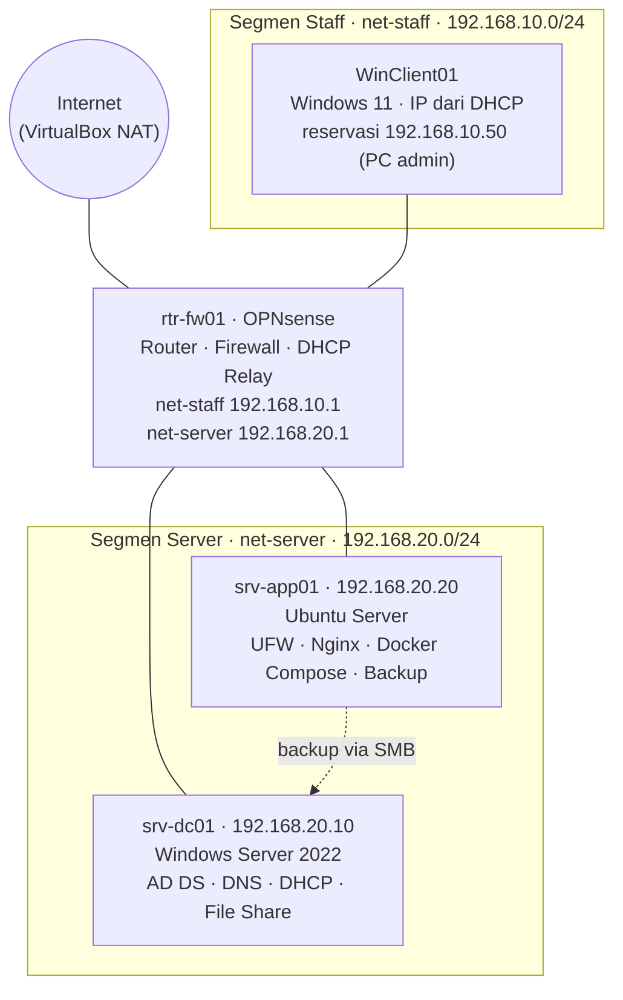
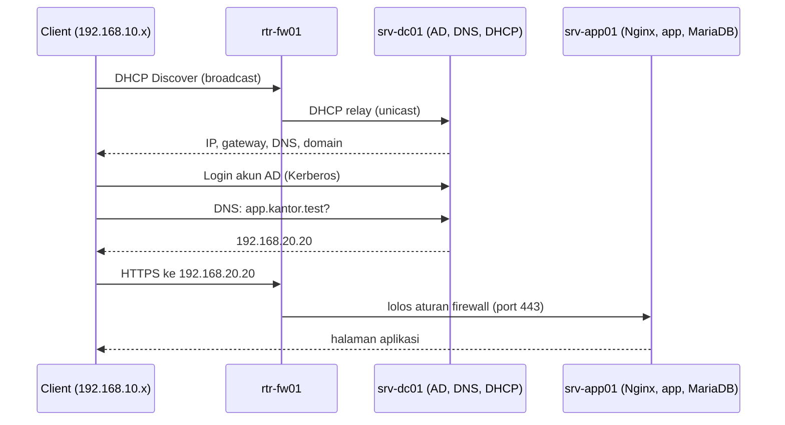

# Cetak Biru Proyek: Small Office Infrastructure
 
**Satu kantor kecil, satu infrastruktur utuh:** jaringan tersegmentasi, login terpusat, aplikasi internal yang diamankan, dan backup yang terbukti bisa dipulihkan.
 
Proyek ini menyatukan semua materi roadmap (Networking, Docker, Windows Server & AD, Ubuntu Server) ke dalam satu skenario yang bisa dijalankan di laptop 16 GB dengan VirtualBox, lalu didokumentasikan sebagai repo portofolio.
 
---
 
## 1. Skenario dan Tujuan
 
**Skenario:** sebuah kantor dengan sekitar 15 karyawan membutuhkan:
1. Login terpusat dan hak akses per divisi, bukan akun lokal di tiap komputer.
2. Jaringan karyawan terpisah dari jaringan server.
3. Aplikasi web internal yang hanya bisa diakses secara terkontrol.
4. Backup otomatis yang **terbukti** bisa dipulihkan setelah data hilang.
**Yang ingin dibuktikan lewat proyek ini:** kamu bisa merancang, membangun, mengamankan, mengotomasi, dan menguji sebuah infrastruktur dari ujung ke ujung, bukan hanya mengoperasikan tiap layanan secara terpisah.
 
---
 
## 2. Arsitektur
 

 
**Alur satu permintaan, dari menyalakan PC sampai membuka aplikasi:**
 

 
### Tabel mesin virtual
 
| VM | Peran | IP | RAM | Catatan |
|---|---|---|---|---|
| `rtr-fw01` | Router, firewall, DHCP relay | `.10.1` dan `.20.1` (+ NAT) | 2 GB | OPNsense (alternatif: pfSense CE atau VyOS) |
| `srv-dc01` | AD DS, DNS, DHCP, file share | `192.168.20.10` | 4 GB | Windows Server 2022 Desktop Experience |
| `srv-app01` | Nginx, Docker Compose, backup | `192.168.20.20` | 2 GB | Ubuntu Server LTS |
| `WinClient01` | Client karyawan sekaligus PC admin | DHCP, reservasi `.10.50` | 4 GB | Windows 11 Enterprise Evaluation. Nyalakan hanya saat menguji |
 
Total maksimum sekitar 12 GB dari 16 GB. Jalankan klien hanya saat pengujian. Kalau terasa berat, turunkan `srv-dc01` ke 3 GB.
 
### Keputusan desain
 
| Keputusan | Pilihan | Alasan |
|---|---|---|
| Router | VM OPNsense, bukan Packet Tracer | Packet Tracer tidak bisa terhubung ke VM VirtualBox, jadi jalur data nyata butuh router yang juga VM. OPNsense gratis tanpa akun, punya DHCP relay, firewall, dan WireGuard bawaan |
| Segmentasi | Dua VirtualBox Internal Network (`net-staff`, `net-server`) | Berfungsi sebagai dua segmen Layer 3 terpisah. Ini bukan VLAN 802.1Q bertag, dan sebaiknya disebut jujur sebagai segmentasi per subnet |
| Nama domain | `kantor.test` | `.test` dicadangkan untuk pengujian (RFC 2606), jadi tidak bentrok dengan mDNS seperti `.local` |
| Letak Nginx | Terpasang di host `srv-app01`, bukan di container | Port 80/443 dikelola UFW dengan benar (lihat bagian Keamanan) |
| Aplikasi | Aplikasi web sederhana + MariaDB | Fokus proyek ada di infrastruktur. Rekomendasi: Snipe-IT (inventaris aset IT) atau aplikasi kecil buatan sendiri |
 
---
 
## 3. Rancangan per Komponen
 
### 3.1 Jaringan dan Router (`rtr-fw01`)
- Tiga adapter: WAN (NAT), `net-staff` (`192.168.10.1/24`), `net-server` (`192.168.20.1/24`).
- Matikan DHCP server bawaan router. Aktifkan **DHCP relay** pada `net-staff` yang meneruskan ke `192.168.20.10`.
- NAT keluar agar semua VM bisa melakukan update paket.
**Aturan firewall antar segmen (prinsip: tolak semua, izinkan yang perlu):**
 
| Dari | Ke | Port | Aksi | Alasan |
|---|---|---|---|---|
| Staff | `srv-dc01` | DNS, Kerberos, LDAP, SMB, RPC (port layanan AD) | Izinkan | Login domain, GPO, file share |
| Staff | `srv-app01` | 80, 443 | Izinkan | Mengakses aplikasi |
| `192.168.10.50` | `srv-app01` | 22 | Izinkan | SSH dari PC admin saja |
| Staff (lainnya) | `srv-app01` | selain 80/443 | Tolak | Least privilege |
| Server | Internet | semua | Izinkan | Update paket |
| Internet | Server/Staff | semua | Tolak | Default |
 
Untuk port AD, mulai dari mengizinkan semua trafik ke `srv-dc01`, lalu persempit sambil mencatat port yang **terbukti** dibutuhkan. Hasil pencatatannya jadi bahan dokumentasi yang bagus.
 
### 3.2 Identitas dan Layanan Windows (`srv-dc01`)
- **AD DS** domain `kantor.test`, NetBIOS `KANTOR`.
- **OU:** `Departemen` → `IT`, `Staff`. **Group:** `GRP-IT`, `GRP-Staff`. Beberapa user per group.
- **DNS:** zona `kantor.test`, forwarder ke router, record `app.kantor.test` → `192.168.20.20`.
- **DHCP:** scope `192.168.10.100 – 192.168.10.200`, option 003 (router) `192.168.10.1`, option 006 (DNS) `192.168.20.10`, option 015 `kantor.test`, reservasi `192.168.10.50` untuk PC admin.
  *(Berbeda dari lab sebelumnya: di sini option 003 **diisi**, karena sekarang ada router.)*
- **GPO:** satu kebijakan untuk OU `Staff` (misalnya blokir Control Panel) dan kebijakan password domain yang jelas.
- **File share:** `\\srv-dc01\Staff`, `\\srv-dc01\IT`, dan `\\srv-dc01\Backup`. Akses diatur lewat NTFS berbasis group. Share `Backup` hanya untuk `GRP-IT` dan akun layanan backup.
### 3.3 Server Aplikasi (`srv-app01`)
- **Akses:** login SSH hanya dengan key, login password dimatikan, login root dimatikan.
- **Firewall UFW:**
```
sudo ufw default deny incoming
sudo ufw default allow outgoing
sudo ufw allow from 192.168.10.50 to any port 22 proto tcp
sudo ufw allow from 192.168.10.0/24 to any port 80,443 proto tcp
sudo ufw enable
```
- **Docker Compose** (kerangka; sesuaikan image aplikasinya):
```yaml
services:
  db:
    image: mariadb:11
    restart: unless-stopped
    env_file: .env
    volumes:
      - db_data:/var/lib/mysql
    # sengaja tanpa "ports:", MariaDB hanya terjangkau dari network Compose
 
  app:
    image: <image-aplikasi>
    restart: unless-stopped
    env_file: .env
    depends_on:
      - db
    ports:
      - "127.0.0.1:8080:80"   # hanya bisa diakses Nginx di host
 
volumes:
  db_data:
```
- **Nginx reverse proxy** (di host):
```nginx
server {
    listen 80;
    server_name app.kantor.test;
    return 301 https://$host$request_uri;
}
 
server {
    listen 443 ssl;
    server_name app.kantor.test;
    ssl_certificate     /etc/ssl/kantor/app.crt;
    ssl_certificate_key /etc/ssl/kantor/app.key;
 
    location / {
        proxy_pass http://127.0.0.1:8080;
        proxy_set_header Host $host;
        proxy_set_header X-Real-IP $remote_addr;
        proxy_set_header X-Forwarded-Proto $scheme;
    }
}
```
  Sertifikat memakai self-signed (catat sebagai batasan di dokumentasi).
 
> **Jebakan penting: Docker melewati UFW.** Port yang dipublikasikan Docker (`-p` atau `ports:`) menulis aturan iptables sendiri dan lolos dari UFW. Karena itu MariaDB tidak punya `ports:`, dan aplikasi diikat ke `127.0.0.1` sehingga hanya Nginx yang bisa menjangkaunya. Membuktikan hal ini (lewat pengujian dari klien) adalah salah satu bagian paling bernilai di portofolio.
 
### 3.4 Backup dan Pemulihan Bencana
- **Skrip `backup-db.sh`** (kerangka):
```bash
#!/usr/bin/env bash
set -euo pipefail
 
BACKUP_DIR=/mnt/backup-kantor          # mount SMB dari srv-dc01
STAMP=$(date +%F_%H%M)
LOG=/var/log/backup-db.log
trap 'echo "$(date -Is) backup GAGAL" >> "$LOG"' ERR
 
cd /opt/app
docker compose exec -T db sh -c \
  'mariadb-dump -u root -p"$MARIADB_ROOT_PASSWORD" --single-transaction --all-databases' \
  | gzip > "$BACKUP_DIR/db_$STAMP.sql.gz"
 
tar czf "$BACKUP_DIR/config_$STAMP.tar.gz" \
  /opt/app/docker-compose.yml /etc/nginx/sites-available
 
find "$BACKUP_DIR" -name '*.gz' -mtime +7 -delete
echo "$(date -Is) backup OK $STAMP" >> "$LOG"
```
  File `.env` tidak ikut dibackup ke share. Simpan secret di password manager.
- **systemd timer** (tengah malam, tetap jalan walau VM sempat mati):
```ini
# /etc/systemd/system/backup-db.service
[Unit]
Description=Backup database dan konfigurasi
 
[Service]
Type=oneshot
ExecStart=/opt/scripts/backup-db.sh
 
# /etc/systemd/system/backup-db.timer
[Unit]
Description=Backup harian tengah malam
 
[Timer]
OnCalendar=*-*-* 00:00:00
Persistent=true
 
[Install]
WantedBy=timers.target
```
  Pantau dengan `systemctl list-timers` dan `journalctl -u backup-db.service`.
- **Target backup = file share Windows.** `srv-app01` me-mount `\\srv-dc01\Backup` lewat CIFS dengan akun layanan khusus. File kredensial dibuat `chmod 600` dan tidak masuk repo. Ini menyatukan modul File Sharing/NTFS dengan Linux.
- **Uji bencana:** hapus data (atau satu tabel), lalu pulihkan:
```bash
gunzip -c db_<STAMP>.sql.gz | docker compose exec -T db sh -c 'mariadb -u root -p"$MARIADB_ROOT_PASSWORD"'
```
  Catat berapa lama pemulihan memakan waktu (RTO, diukur manual) dan data maksimum yang bisa hilang (RPO: 24 jam untuk backup harian).
 
---
 
## 4. Matriks Pengujian
 
Setiap baris harus punya bukti (screenshot atau output) di folder `evidence/`.
 
| ID | Skenario | Hasil yang diharapkan |
|---|---|---|
| T01 | Klien menyala di `net-staff` | Mendapat IP `192.168.10.x` lewat DHCP relay, gateway `.10.1`, DNS `.20.10` |
| T02 | Klien join domain `kantor.test` | Komputer muncul di AD |
| T03 | Login user divisi Staff | Berhasil, `gpresult /r` menampilkan GPO Staff |
| T04 | User Staff membuka share `IT` | Ditolak |
| T05 | User IT membuka share `IT` | Berhasil |
| T06 | `nslookup app.kantor.test` dari klien | `192.168.20.20` |
| T07 | Buka `https://app.kantor.test` | Aplikasi tampil lewat Nginx |
| T08 | Dari klien (`.10.50`): SSH ke `srv-app01` | Berhasil dengan key |
| T09 | Dari `srv-dc01`: koneksi ke port 22 `srv-app01` | Diblokir (timeout) |
| T10 | Dari klien: `Test-NetConnection 192.168.20.20 -Port 3306` | `False`, database tidak terjangkau |
| T11 | `systemctl list-timers` dan cek file backup | Timer aktif, file backup baru di share |
| T12 | Hapus data, restore dari backup | Aplikasi kembali normal, data pulih |
| T13 | (Opsional) `srv-dc01` mati, user lama login lagi di klien | Berhasil lewat cached credentials |
 
---
 
## 5. Tahapan Eksekusi
 
| Tahap | Isi | Selesai bila |
|---|---|---|
| **0. Persiapan** | Unduh ISO, buat repo kosong, gambar diagram, tetapkan tabel IP | Diagram dan tabel IP sudah ada di repo |
| **1. Jaringan** | `rtr-fw01` dengan tiga adapter, dua segmen, aturan awal | Host di `net-staff` bisa ping host di `net-server` lewat router |
| **2. Identitas** | Domain, DNS, DHCP + relay, join domain, OU/group/GPO, file share | T01 sampai T06 lulus |
| **3. Server aplikasi** | Hardening Ubuntu, Compose, Nginx, record DNS, aturan firewall | T07 sampai T10 lulus |
| **4. Backup & DR** | Skrip, systemd timer, target SMB, uji restore | T11 dan T12 lulus |
| **5. Portofolio** | README, diagram, konfigurasi, bukti, keputusan, batasan | Repo siap dibaca orang asing |
| *Opsional* | WireGuard di `rtr-fw01` untuk akses admin dari luar | Admin bisa SSH lewat tunnel |
 
Bagian tersulit sekaligus yang paling baru bagimu adalah **DHCP relay lintas segmen** (Tahap 1–2). Kerjakan dulu dan didokumentasikan dengan baik.
 
---
 
## 6. Struktur Repo (`small-office-infrastructure`)
 
```
small-office-infrastructure/
├── README.md               # cerita proyek, diagram, tabel hasil uji
├── docs/
│   ├── 00-architecture.md
│   ├── 01-network-router.md
│   ├── 02-identity-windows.md
│   ├── 03-app-server.md
│   ├── 04-backup-dr.md
│   ├── test-matrix.md
│   ├── decisions.md        # kenapa memilih A, bukan B
│   ├── troubleshooting.md  # masalah nyata dan solusinya
│   └── limitations.md      # batasan yang jujur
├── configs/
│   ├── app/                # docker-compose.yml, .env.example
│   ├── nginx/
│   ├── ufw/
│   ├── backup/             # backup-db.sh, restore, unit service dan timer
│   └── windows/            # catatan scope DHCP, daftar GPO
├── diagrams/
└── evidence/               # T01-xxx.png, dst.
```
 
**Aturan repo publik:** jangan commit password, `.env`, private key SSH, atau file kredensial SMB. Sertakan `.env.example` dan masukkan `.env` ke `.gitignore`.
 
---
 
## 7. Kenapa Rancangan Ini Kuat untuk Portofolio
 
- **Ujung ke ujung.** Satu cerita utuh dari menyalakan PC sampai pemulihan bencana, bukan daftar layanan terpisah.
- **Terukur.** Matriks pengujian dengan bukti membuktikan klaim, bukan sekadar menyatakannya.
- **Keputusan tercatat.** `decisions.md` menunjukkan kamu memahami alasan di balik pilihan, yang paling sering ditanyakan saat wawancara.
- **Kegagalan tercatat.** `troubleshooting.md` yang berisi masalah nyata lebih meyakinkan daripada repo yang tampak mulus.
- **Keamanan berlapis.** Firewall router, UFW, key-only SSH, dan database tidak terpublikasi, lengkap dengan bukti pengujiannya.
- **Jujur soal batas.** Bagian `limitations.md` menunjukkan kematangan.
### Batasan yang sebaiknya kamu tulis sendiri
Satu Domain Controller (tanpa high availability), sertifikat self-signed, segmentasi per subnet bukan VLAN bertag, tanpa sistem monitoring terpusat, dan VPN hanya opsional.
 
### Langkah lanjutan setelah selesai (jembatan ke Cloud)
Domain Controller kedua dan replikasi, WireGuard untuk akses admin, Prometheus dan Grafana untuk monitoring, Ansible untuk otomasi konfigurasi, lalu memindahkan `srv-app01` ke layanan cloud dan mendefinisikannya dengan Terraform.
 
---
 
## 8. Cerita untuk Wawancara (isi setelah dikerjakan)
 
1. **Pitch 60 detik:** satu paragraf tentang skenario dan hasil akhirnya.
2. **Tiga masalah tersulit yang kamu pecahkan,** misalnya DHCP relay lintas segmen, Docker yang melewati UFW, dan restore yang gagal pertama kali. Tulis gejala, penyebab, dan perbaikannya.
3. **Satu hal yang akan kamu ubah** kalau ini lingkungan produksi (biasanya: DC kedua, sertifikat dari CA internal, dan monitoring).
 
